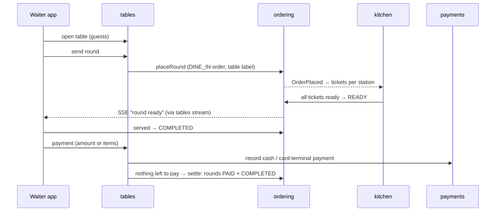

# Table service (waiter app)

## Concepts
- **Floor area** (Salon, Terrace) and **dining table** (label, seats), set up in Admin → Tables.
- **Table session**: guests seated at a table, from sitting down until the bill is paid. A table has at most one open
  session (enforced by a partial unique index). Status `OPEN` → `CLOSED` (paid, or freed with nothing owed) or `MERGED`.
- **Round**: everything sent to the kitchen and bar in one go. Each round is a `DINE_IN` order of the session, so the
  kitchen display, stock consumption and reports treat it like any other order. Its tickets carry the table label.
- **Bill**: the session's rounds that were not cancelled. Payments are recorded against the session, not one order.

## Rules
- **Who:** WAITER, CASHIER, MANAGER and ADMIN use the floor. Areas and tables are managed by MANAGER and ADMIN.
- **Cancelling a round:** the waiter can cancel it while the kitchen has not started; once preparing, a manager must.
  The same rule as any order.
- **Paying:**
  - *Whole bill or equal split:* an amount up to what is left. In the app, the equal share is the remainder divided by
    the people still paying, rounded down, and the last person pays the rest, so the cents add up.
  - *By item:* selected units are charged their share of the line total (`total × units / quantity`). Paying the last
    unpaid units of a line takes whatever is left of it, so a line is never over- or under-charged.
  - Cash payments may record the amount handed over; the change is shown and stored.
  - A payment can be undone (voided) while the table is open, for payments entered by mistake.
  - When nothing is left to pay, the session closes: its rounds are marked paid and served, and the table is free.
    Rounds still in the kitchen can be finished there; that no longer changes a completed order.
- **Transfer:** the guests move to a free table. **Merge:** a table's rounds join another open table and it becomes free.
  Only before any payment, so a payment never changes table.
- **Pre-bill:** prints what was ordered and what is left to pay. It is not a fiscal receipt; the bon fiscal comes with
  the fiscal printer (Phase 6), which will print it when the bill is paid.

## Not yet
- A floor plan drawn to scale (tables are a grid per area).
- Voiding a single item of a round (cancel the round and send a new one).
- QR codes for guests to order from the table.
- Tips.
